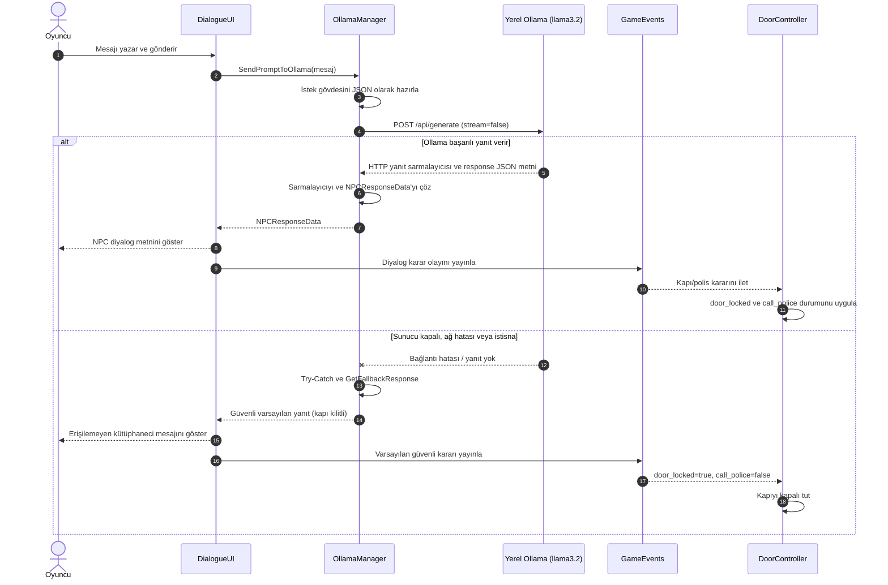

# Breakpoint – Vize Haftası Kütüphane Firarı

Kocaeli Üniversitesi Teknoloji Fakültesi Bilişim Sistemleri Mühendisliği Bölümü Yazılım Geliştirme Laboratuvarı I dersi kapsamında geliştirilen, Unity tabanlı macera ve yapay zekâ prototipidir.

> **Durum notu:** Bu belge, istenen hedef mimariyi ve depodaki mevcut uygulamayı birlikte açıklar. Depodaki `OllamaManager` şu anda `dialogue`, `door_locked`, `call_police` alanlarını `JsonUtility` ile işler; istenen `dialogue_text` ve `mood` alanları mevcut `NPCResponseData` sınıfında henüz yoktur. Ayrıca kodda istek zaman aşımı 30 saniyedir. Aşağıdaki test sonuçları için gerçek ölçüm verisi sağlanmadığından sonuç uydurulmamış, ölçüm tablosu doldurulabilir biçimde bırakılmıştır.

## İçindekiler

- [Proje özeti](#proje-özeti-ve-giriş)
- [Mimari ve OOP tasarımı](#mimari-ve-oop-tasarımı)
- [Otonom AI kahraman](#otonom-ai-kahraman)
- [Yerel LLM ve diyalog mimarisi](#yerel-llm-ve-diyalog-mimarisi)
- [Hata yönetimi ve resiliency](#hata-yönetimi-ve-resiliency)
- [Kurulum ve çalıştırma](#kurulum-ve-çalıştırma)
- [Ekran görüntüleri](#oyun-içi-ekran-görüntüleri-ve-arayüz)
- [Sonuç ve gelecek çalışmalar](#sonuç-sınırlılıklar-ve-gelecek-çalışmalar)

## Proje özeti ve giriş

Vize haftasında gece boyunca kütüphanede çalışan bir mühendislik öğrencisi, binanın kilitlenmesiyle içeride mahsur kalır. Oyuncu, otonom companion robotunun yardımıyla lazer barikatlarını devre dışı bırakıp çıkışa ulaşmaya çalışır. Çıkış kapısında karşısına çıkan kuralcı Nöbetçi Kütüphaneci’yi ikna etmek için serbest metinle bir mazeret sunar. Yerel dil modeli, bu metne göre NPC diyaloğunu ve kapı/polis kararını üretir.

Projenin amacı; Unity’de sahne ve oyun durumu yönetimini, NavMesh tabanlı otonom hareketi, algılayıcılarla etkileşimi, olay tabanlı bileşen iletişimini ve yerel bir LLM ile asenkron etkileşimi tek bir oynanabilir senaryoda birleştirmektir. Minimum oyun döngüsü şöyledir:

1. Oyuncu koridor bölümünde robotun şaltere gitmesini sağlar.
2. Robot NavMesh üzerinde hedefe ilerler, Raycast ile şalteri algılar ve lazerleri kapatır.
3. Oyuncu kapı bölümüne geçer ve Nöbetçi Kütüphaneci’ye bir mesaj yazar.
4. LLM yanıtı yapılandırılmış veri olarak alınır; kapı açık/kapalı ve polis çağrısı durumları oyuna uygulanır.
5. `GameClock` 04:00–09:00 aralığında ilerler; süre dolduğunda oyun zaman aşımı olayını yayınlar.

## Ekip

| Üye | Sorumluluk |
|---|---|
| **Sütlaç** | Fiziksel dünya ve robot ajanı: NavMesh, sensörler ve koridor bölümü |
| **Tiramisu** | Yapay zekâ: yerel LLM/Ollama entegrasyonu, JSON diyalog ve asenkron C# akışı; kapı bölümü |

## Mimari ve OOP tasarımı

Kod, `Assets/_Project/Scripts` altında sorumluluklarına göre `Core`, `LLM`, `Player` ve `Robot` klasörlerine ayrılmıştır. Sahne dosyaları `Assets/Scenes` altındadır (`Level_Corrider` ve `Level_Door`). Bileşenler Unity `MonoBehaviour` yaşam döngüsüne uyumlu, Inspector üzerinden yapılandırılabilir nesneler olarak tasarlanmıştır.

### Temel sınıflar

| Sınıf | Sorumluluk |
|---|---|
| `GameManager` | Oyun akışını ve yüksek seviyeli durum geçişlerini koordine eder. |
| `GameState` | Oyunun durumunu temsil eden ortak durum tanımlarını sağlar. |
| `GameEvents` | Lazerlerin devre dışı bırakılması ve zamanın dolması gibi olayları yayınlar. |
| `GameClock` | Oyun içi saati 04:00–09:00 arasında ilerletir; süre dolunca `OnTimeExpired` olayını tetikler. Varsayılan gerçek süre 600 saniyedir. |
| `OllamaManager` | Ollama HTTP isteğini gönderir, yanıt sarmalayıcısını çözer ve uygulama verisini üretir. |
| `NPCResponseData` | NPC metni, kapı kilit durumu ve polis çağrısı alanlarını taşır. |
| `DialogueUI` | Oyuncu metnini alır, yanıtı ekranda sunar ve ilgili oyun bileşenlerine aktarır. |
| `DoorController` | Kapının açılma/kilit ve güvenlik kararlarını oyun nesnesine uygular. |
| `RobotController` | Robotun FSM durumlarını, NavMesh hedef hareketini, Raycast taramasını ve şalter etkileşimini yürütür. |
| `PlayerController` | Oyuncu girdisi ve oyuncu hareketi sorumluluklarını yürütür. |

### OOP ve SOLID ilkeleri

- **Tek Sorumluluk (SRP):** Saat, diyalog, kapı, robot hareketi ve LLM iletişimi ayrı bileşenlerde tutulur. Örneğin `GameClock` HTTP veya UI işlemi yapmaz.
- **Açık/Kapalı (OCP):** Olaylara abone olan yeni sistemler, temel yayıncı akışını değiştirmeden eklenebilir. Yeni NPC davranışları da yanıt işleme sınırında genişletilebilir.
- **Liskov Yerine Geçme (LSP):** Projede belirgin bir kalıtım hiyerarşisi kullanılmamaktadır; Unity bileşenleri kompozisyonla bir araya getirilir.
- **Arayüz Ayrımı (ISP):** `ICursorController` gibi küçük arayüzler, tüketicilerin ihtiyaç duymadıkları davranışlara bağımlı olmamasını sağlar.
- **Bağımlılığı Tersine Çevirme (DIP):** `GameEvents` üzerinden gevşek bağlı iletişim, doğrudan nesne referanslarına olan ihtiyacı azaltır. Mevcut LLM/UI bağlantılarında Unity Inspector referansları da kullanılır; bu nedenle DIP uygulaması tüm sistemde mutlak değildir.

Bu ilkeler, mevcut kodun gözlemlenebilir yapısına göre açıklanmıştır; her sınıf için bağımsız arayüz veya dependency injection altyapısı bulunduğu iddia edilmemektedir.

## Otonom AI kahraman

Robot `NavMeshAgent` ile pişirilen NavMesh yüzeyinde yol bulur. `RobotController` hedefe `MoveTo` durumunda ilerler; yol hesabı tamamlanıp hedefe 0,5 birimden yakın olduğunda durur ve `Scan` durumuna geçer. Sensör başlangıcı `sensorPoint` atanmışsa o noktadır, değilse robotun konumudur. İleri yönde `sensorRange` (varsayılan 5 birim) uzunluğunda fiziksel Raycast atılır. Çarpılan nesnenin etiketi `Salter` ise robot `Interact` durumuna geçer; lazer bariyeri kapatılır ve `GameEvents` üzerinden lazer olayı yayınlanır.

### Robot FSM akışı


> **Uygulama ayrıntısı:** Depodaki `RobotController` içinde `NavMeshAgent` alınması ve FSM/Raycast/etkileşim akışı vardır. Hedefe `SetDestination` çağrısını yapan komut bağlantısı sahne ya da başka bir bileşende kurulmalıdır. Projeye ait beş başlangıç noktasının ham ölçüm kayıtları depoda bulunmadığından aşağıdaki tablo sonuç iddiası değil, test raporu şablonudur.

### Beş başlangıç noktasından yol bulma ve şaltere erişim testi

| Deneme | Başlangıç noktası | Yol bulundu | Şaltere ulaşıldı | Süre (sn) | Not |
|---:|---|---|---|---:|---|
| 1 | Nokta A | Ölçüm gerekli | Ölçüm gerekli | — | NavMesh erişilebilirliği kaydedilmeli |
| 2 | Nokta B | Ölçüm gerekli | Ölçüm gerekli | — | NavMesh erişilebilirliği kaydedilmeli |
| 3 | Nokta C | Ölçüm gerekli | Ölçüm gerekli | — | NavMesh erişilebilirliği kaydedilmeli |
| 4 | Nokta D | Ölçüm gerekli | Ölçüm gerekli | — | NavMesh erişilebilirliği kaydedilmeli |
| 5 | Nokta E | Ölçüm gerekli | Ölçüm gerekli | — | NavMesh erişilebilirliği kaydedilmeli |

Başarı oranı ve ortalama süre, beş deneme gerçek Unity çalıştırmalarında tamamlandıktan sonra hesaplanmalıdır. Ölçümde başlangıç koordinatı, hedef koordinatı, NavMesh bake ayarı ve zaman ölçüm yöntemi sabit tutulmalıdır.

## Yerel LLM ve diyalog mimarisi

Ollama, modelin yerel makinede çalışmasını sağlar; böylece oyun diyaloğu için harici bir bulut servisine ihtiyaç duyulmaz. `llama3.2` modeli hafif kurulumlarda denenebilir ve istekler ana Unity iş parçacığını uzun süre bloklamadan `UnityWebRequest` ve `Task.Yield` ile beklenebilir. Bu yaklaşım donanım kaynaklarına bağlıdır; 1B varyantının düşük VRAM ve kısa gecikme avantajı hedefleniyorsa kullanılan model etiketi kurulumda açıkça `llama3.2:1b` olarak seçilmelidir. Depodaki varsayılan `modelName` değeri şu an `llama3.2`’dir.

### İstek ve yanıt sözleşmesi

Sistem yönergesi NPC’yi gece nöbetindeki kuralcı kütüphaneci olarak tanımlar. Mantıklı ve resmi mazerette kapının açılması, anlamsız mesajda kapının kapalı kalması, hakaret veya zorla kaçma teşebbüsünde polis çağrılması kurallarını belirtir. Üretilen yanıt yalnızca JSON olmalıdır.

İstenen hedef şema:

```json
{
  "dialogue_text": "Kütüphanecinin oyuncuya yanıtı",
  "mood": "calm | annoyed | alarmed",
  "door_locked": true,
  "call_police": false
}
```

Mevcut `NPCResponseData` ve `OllamaManager` uygulamasının beklediği şema:

```json
{
  "dialogue": "Kütüphanecinin oyuncuya yanıtı",
  "door_locked": true,
  "call_police": false
}
```

Ollama `/api/generate` uç noktasının dış yanıtındaki `response` metni ayrıca çözülür. Model yanıtı, uygulama tarafında `NPCResponseData` nesnesine dönüştürülür. Mevcut projede Newtonsoft.Json değil Unity `JsonUtility` kullanılmaktadır. Hedef şemadaki `dialogue_text` ve `mood` alanlarının kullanılabilmesi için C# DTO, prompt ve tüketici kodlarının birlikte güncellenmesi gerekir.

### Diyalog istek/yanıt sırası



### Örnek diyalog senaryoları

Aşağıdaki JSON’lar hedef şema ile örneklenen beklenen model çıktılarıdır; canlı model çıktısının her çalıştırmada aynı olacağı garanti edilmez. Bugünkü DTO uyumluluğunda `dialogue_text` alanı `dialogue` olarak yazılmalı ve `mood` alanı çıkarılmalıdır.

| Senaryo | Oyuncu mesajı | Örnek JSON yanıtı | Oyun durumuna etkisi |
|---|---|---|---|
| **İkna eden** | “Sayın görevli, sabah teslim etmem gereken sınav projemi tamamlamak için içeride kaldım. Kimliğimi ve danışman onayımı gösterebilirim.” | `{"dialogue_text":"Mazeretiniz makul görünüyor. Bu kez çıkışa izin veriyorum.","mood":"calm","door_locked":false,"call_police":false}` | Kapı açılır; polis çağrılmaz. |
| **Kızdıran** | “Kurallarınızı umursamıyorum, hemen aç şu kapıyı!” | `{"dialogue_text":"Bu üslup kabul edilemez. Güvenlik görevlilerine haber veriyorum.","mood":"alarmed","door_locked":true,"call_police":true}` | Kapı kilitli kalır; polis/güvenlik olayı başlatılır. |
| **Saçmalayan** | “Üç mor bulut kantinde satranç oynarken saat neden kare?” | `{"dialogue_text":"Anlaşılır bir mazeret sunmadınız. Kapı kapalı kalacak.","mood":"annoyed","door_locked":true,"call_police":false}` | Kapı kilitli kalır; ek güvenlik çağrısı yapılmaz. |
| **Rüşvet teklif eden** | “Size para vereyim, kapıyı açın.” | `{"dialogue_text":"Rüşvet teklifini reddediyorum. Kurallar gereği çıkış izni veremem.","mood":"annoyed","door_locked":true,"call_police":false}` | Kapı kilitli kalır. İstenirse bu davranış sistem promptunda açıkça polis çağrısı kuralına bağlanmalıdır. |
| **Resmi dilekçe sunan** | “Kütüphane Müdürlüğüne: Acil sağlık durumum nedeniyle binadan çıkış izni arz ederim. Saygılarımla.” | `{"dialogue_text":"Dilekçeniz ve gerekçeniz uygun. Kapıyı açıyorum.","mood":"calm","door_locked":false,"call_police":false}` | Kapı açılır; polis çağrılmaz. |

## Hata yönetimi ve resiliency

LLM, oyun döngüsünün dış bağımlılığı olduğundan başarısızlığı temel oyun akışını çöktürmemelidir. `OllamaManager` şu güvenlik adımlarını uygular:

- `UnityWebRequest` başarısız sonuç döndürürse uyarı kaydı üretir ve `GetFallbackResponse` döndürür.
- İstek sırasında oluşan istisnalar `try-catch` ile yakalanır; arayüze güvenli varsayılan yanıt verilir.
- Ollama dış JSON sarmalayıcısı boşsa, içerideki JSON bozuksa veya gerekli diyalog alanı yoksa parse hatası fallback ile karşılanır.
- Fallback kapıyı kilitli (`door_locked = true`) ve polis çağrısını kapalı (`call_police = false`) tutar; oyuncu yine anlaşılır bir hata diyaloğu görür.
- İstek, yanıt tamamlanana kadar `Task.Yield` ile beklenir. Bu, Unity ana iş parçacığını senkron beklemeyle kilitlememek içindir.

**Zaman aşımı notu:** Proje açıklamasında hedef 8 saniye olarak belirtilmiştir; mevcut `OllamaManager.cs` içindeki `UnityWebRequest.timeout` ise 30 saniyedir. Gerçek davranış kodda tanımlı bu değerdir. İstenen 8 saniye sınırına geçmek için istek zaman aşımı ayarı güncellenmelidir. `Task.Yield` asenkron bekleme sağlar, tek başına zaman aşımı süresi belirlemez.

## Kurulum ve çalıştırma

1. Depoyu Unity Hub ile, proje tarafından kullanılan uyumlu Unity sürümünde açın. Render ayarları Universal Render Pipeline (URP) yapılandırması içerir.
2. Ollama’yı yerel makineye kurup çalıştırın. Model etiketini indirin (ör. `ollama pull llama3.2`). 1B varyantı hedefleniyorsa hem model indirme hem de `OllamaManager.modelName` değeri `llama3.2:1b` ile eşleştirilmelidir.
3. Ollama servisinin varsayılan `http://localhost:11434` adresinde erişilebilir olduğunu doğrulayın. Projedeki uç nokta `http://localhost:11434/api/generate` şeklindedir.
4. `Assets/Scenes/Level_Corrider.unity` koridor ve `Assets/Scenes/Level_Door.unity` kapı bölümü için kullanılır. Sahne geçişi `LevelGecisi.cs` tarafından yönetilir.
5. Unity Editor’da koridor sahnesinden oyunu başlatın. Sahne nesnelerindeki NavMeshAgent, NavMesh yüzeyi, `Salter` etiketi, UI alanları ve Inspector referanslarının atanmış olduğundan emin olun.

LLM servisi çalışmıyorsa oyun fallback yanıtıyla devam eder; doğal dil diyalog üretimi kullanılabilir olmaz.

## Oyun içi ekran görüntüleri ve arayüz

Görseller depoya eklendikten sonra aşağıdaki yollar ilgili dosyalara göre güncellenmelidir.

| Görünüm | Görsel |
|---|---|
| Koridor ve lazer bariyerleri |  |
| Robot ve şalter etkileşimi |  |
| Nöbetçi Kütüphaneci diyalog arayüzü |  |
| Kapı ve oyun sonu |  |

## Sonuç, sınırlılıklar ve gelecek çalışmalar

Breakpoint; NavMesh ile otonom hareketi, Raycast algılamasını, FSM tabanlı robot davranışını, olay güdümlü oyun sistemlerini ve yerel LLM ile diyalog prototipini bir araya getirir. Yerel model kullanımı, oyuncu girdisinin harici bir servise gönderilmeden işlenebilmesine imkân verir. Güvenli fallback sayesinde LLM erişimi olmadığında temel hata akışı tanımlıdır.

Mevcut sınırlılıklar arasında model yanıt süresinin donanıma göre değişmesi, modelin her zaman geçerli JSON üretmemesi, sahne bağlantılarının Inspector yapılandırmasına bağlı olması ve ölçümlü beş başlangıç noktası test sonuçlarının henüz raporlanmamış olması yer alır. Depodaki LLM DTO şeması hedeflenen `dialogue_text`/`mood` sözleşmesinden farklıdır; model promptu, DTO ve UI/kapı tüketicileri tek bir sürümlü sözleşmede eşitlenmelidir. Zaman aşımı da belirtilen 8 saniye hedefiyle kodda bulunan 30 saniye değerinden biri olarak netleştirilmelidir.

Gelecek çalışmalar:

- `NPCResponseData` şemasına `dialogue_text` ve `mood` alanlarını ekleyip JSON doğrulama ve eski yanıt uyumluluğu sağlamak.
- Ollama model etiketi, yanıt sıcaklığı, token sınırı ve 8 saniyelik zaman aşımını Inspector veya yapılandırma dosyasından yönetmek.
- Beş farklı başlangıç noktasında tekrarlı yol bulma testleri yapıp başarı oranı ve süre istatistiklerini raporlamak.
- Robotun engelden kaçınma, görüş alanı, yeniden hedefleme ve hata durumları için FSM’yi genişletmek.
- Unity ML-Agents ile davranış klonlama veya ödül tabanlı öğrenmeyi araştırmak; mevcut deterministik FSM’yi kıyaslama tabanı olarak korumak.
- Diyalog kararlarını otomatik testlerle doğrulamak ve bağlantı, timeout, hatalı JSON senaryolarını CI sürecine eklemek.

## Lisans ve atıf

Bu proje ders/prototip çalışmasıdır. Lisans ve üçüncü taraf varlık atıfları depoda tanımlandığında bu bölüm ilgili lisans metinleriyle tamamlanmalıdır.
