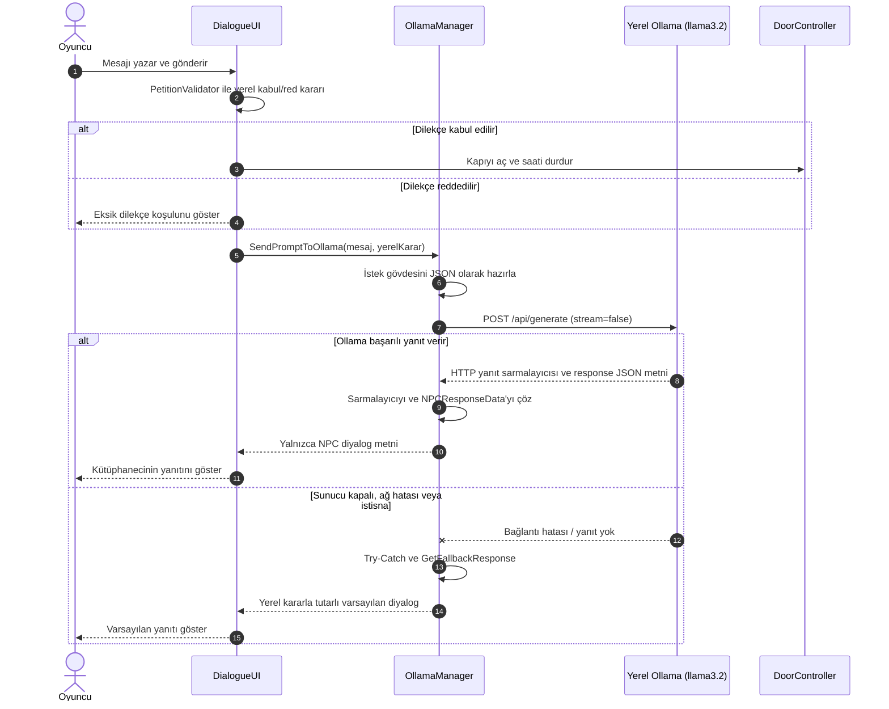

# Breakpoint – Vize Haftası Kütüphane Firarı

Kocaeli Üniversitesi Teknoloji Fakültesi Bilişim Sistemleri Mühendisliği Bölümü Yazılım Geliştirme Laboratuvarı I dersi kapsamında geliştirilen, Unity tabanlı macera ve yapay zekâ prototipidir.

> **Durum notu:** Kapı kararı artık yerel `PetitionValidator` kurallarıyla verilir; Ollama yalnızca kütüphaneci diyaloğunu üretir. Model yanıtı gelmese bile geçerli dilekçe kapıyı açabilir. Ollama isteği varsayılan 8 saniyede zaman aşımına uğrar. Aşağıdaki robot test tablosu gerçek ölçüm verisi sağlanmadığı için doldurulabilir şablon olarak bırakılmıştır.

## İçindekiler

- [Proje özeti](#proje-özeti-ve-giriş)
- [Mimari ve OOP tasarımı](#mimari-ve-oop-tasarımı)
- [Otonom AI kahraman](#otonom-ai-kahraman)
- [Yerel LLM ve diyalog mimarisi](#yerel-llm-ve-diyalog-mimarisi)
- [Hata yönetimi ve resiliency](#hata-yönetimi-ve-resiliency)
- [Kurulum ve çalıştırma](#kurulum-ve-çalıştırma)
- [Ekran görüntüleri](#oyun-içi-ekran-görüntüleri-ve-arayüz)
- [Sonuç ve gelecek çalışmalar](#sonuç-sınırlılıklar-ve-gelecek-çalışmalar)

## Proje özeti ve giriş

Vize haftasında gece boyunca kütüphanede çalışan bir mühendislik öğrencisi, binanın kilitlenmesiyle içeride mahsur kalır. Oyuncu, otonom companion robotunun yardımıyla lazer barikatlarını devre dışı bırakıp çıkışa ulaşmaya çalışır. Çıkış kapısında karşısına çıkan kuralcı Nöbetçi Kütüphaneci’yi ikna etmek için serbest metinle bir mazeret sunar. Yerel dil modeli, bu metne göre NPC diyaloğunu ve kapı/polis kararını üretir.

Projenin amacı; Unity’de sahne ve oyun durumu yönetimini, NavMesh tabanlı otonom hareketi, algılayıcılarla etkileşimi, olay tabanlı bileşen iletişimini ve yerel bir LLM ile asenkron etkileşimi tek bir oynanabilir senaryoda birleştirmektir. Minimum oyun döngüsü şöyledir:

1. Oyuncu koridor bölümünde robotun şaltere gitmesini sağlar.
2. Robot NavMesh üzerinde hedefe ilerler, Raycast ile şalteri algılar ve lazerleri kapatır.
3. Oyuncu kapı bölümüne geçer ve Nöbetçi Kütüphaneci’ye bir mesaj yazar.
4. LLM yanıtı yapılandırılmış veri olarak alınır; kapı açık/kapalı ve polis çağrısı durumları oyuna uygulanır.
5. `GameClock` 04:00–09:00 aralığında ilerler; süre dolduğunda oyun zaman aşımı olayını yayınlar.

## Ekip

| Üye | Sorumluluk |
|---|---|
| **Sütlaç** | Fiziksel dünya ve robot ajanı: NavMesh, sensörler ve koridor bölümü |
| **Tiramisu** | Yapay zekâ: yerel LLM/Ollama entegrasyonu, JSON diyalog ve asenkron C# akışı; kapı bölümü |

## Mimari ve OOP tasarımı

Kod, `Assets/_Project/Scripts` altında sorumluluklarına göre `Core`, `LLM`, `Player` ve `Robot` klasörlerine ayrılmıştır. Sahne dosyaları `Assets/Scenes` altındadır (`MainMenu`, `Level_Corridor` ve `Level_Door`). Bileşenler Unity `MonoBehaviour` yaşam döngüsüne uyumlu, Inspector üzerinden yapılandırılabilir nesneler olarak tasarlanmıştır.

### Temel sınıflar

| Sınıf | Sorumluluk |
|---|---|
| `GameManager` | Oyun akışını ve yüksek seviyeli durum geçişlerini koordine eder. |
| `GameState` | Oyunun durumunu temsil eden ortak durum tanımlarını sağlar. |
| `GameEvents` | Lazerlerin devre dışı bırakılması ve zamanın dolması gibi olayları yayınlar. |
| `GameClock` | Oyun içi saati 04:00–09:00 arasında ilerletir; süre dolunca `OnTimeExpired` olayını tetikler. Varsayılan gerçek süre 600 saniyedir. |
| `OllamaManager` | Ollama HTTP isteğini gönderir, yanıt sarmalayıcısını çözer ve uygulama verisini üretir. |
| `NPCResponseData` | NPC metni, kapı kilit durumu ve polis çağrısı alanlarını taşır. |
| `DialogueUI` | Oyuncu metnini alır, yanıtı ekranda sunar ve ilgili oyun bileşenlerine aktarır. |
| `DoorController` | Kapının açılma/kilit ve güvenlik kararlarını oyun nesnesine uygular. |
| `RobotController` | Robotun FSM durumlarını, NavMesh hedef hareketini, Raycast taramasını ve şalter etkileşimini yürütür. |
| `PlayerController` | Oyuncu girdisi ve oyuncu hareketi sorumluluklarını yürütür. |

### OOP ve SOLID ilkeleri

- **Tek Sorumluluk (SRP):** Saat, diyalog, kapı, robot hareketi ve LLM iletişimi ayrı bileşenlerde tutulur. Örneğin `GameClock` HTTP veya UI işlemi yapmaz.
- **Açık/Kapalı (OCP):** Olaylara abone olan yeni sistemler, temel yayıncı akışını değiştirmeden eklenebilir. Yeni NPC davranışları da yanıt işleme sınırında genişletilebilir.
- **Liskov Yerine Geçme (LSP):** Projede belirgin bir kalıtım hiyerarşisi kullanılmamaktadır; Unity bileşenleri kompozisyonla bir araya getirilir.
- **Arayüz Ayrımı (ISP):** `ICursorController` gibi küçük arayüzler, tüketicilerin ihtiyaç duymadıkları davranışlara bağımlı olmamasını sağlar.
- **Bağımlılığı Tersine Çevirme (DIP):** `GameEvents` üzerinden gevşek bağlı iletişim, doğrudan nesne referanslarına olan ihtiyacı azaltır. Mevcut LLM/UI bağlantılarında Unity Inspector referansları da kullanılır; bu nedenle DIP uygulaması tüm sistemde mutlak değildir.

Bu ilkeler, mevcut kodun gözlemlenebilir yapısına göre açıklanmıştır; her sınıf için bağımsız arayüz veya dependency injection altyapısı bulunduğu iddia edilmemektedir.

## Otonom AI kahraman

Robot `NavMeshAgent` ile zemine bake edilmiş NavMesh üzerinde yol bulur. Takip ve FSM güncellemeleri 0,15 saniyelik coroutine ile yürütülür. Takip mesafesi doğrudan `Vector3.Distance` ile ölçülür; durma mesafesi 1,8 birimdir. Oyuncu şaltere tıklarsa `PlayerController`, `Salter` etiketli hedefi doğrudan robota iletir. Robot hedefe yaklaşınca şalteri çalıştırır; normal hedeflerde `sensorPoint` üzerinden ileri raycast kullanılır. Tam yol bulunamazsa robot kısmi yolun erişilebilir ucuna ilerler. Koridor sahnesinde zemin üzerindeki NavMesh yüzeyi kullanılmalı; Robot altındaki eski ikinci `NavMeshSurface` devre dışıdır.

Koridor kontrolleri: `WASD` veya ok tuşlarıyla hareket, fareyle bakış, `Space` ile zıplama, `F` ile el feneri, sol tıklamayla robot komutu ve `Escape` ile duraklatma menüsü açılır. Gamepad’de sol çubuk hareket, sağ çubuk bakış, A/× zıplama, X/□ el feneri, sağ omuz tuşu robot komutu, Start duraklatmadır. Duraklatma menüsünden ana ses, fare hassasiyeti, ters dikey bakış ve tam ekran ayarlanıp kaydedilebilir. Girişler Unity Input System paketini kullanır. Nişangâh şaltere bakarken yeşile döner ve robot komut ipucunu gösterir.

Ana menü gamepad ile de kullanılabilir: D-pad veya sol çubukla seçenek değişir, A/× seçer, B/○ çıkar.

Kazanma ve kaybetme ekranlarında geçen oyun süresi gösterilir; kazanma süresi yerel en iyi kaçış rekoru olarak saklanır. D-pad veya sol çubukla “Tekrar Oyna” ve “Ana Menü” arasında seçim yapılır; A/× seçer, B/○ ana menüye döner.

Saat göstergesinin yanında hedef paneli bulunur. Şalter devre dışı bırakılınca hedef çıkışa ulaşmak olarak değişir; kapı sahnesinde dilekçe ve çıkış adımlarını gösterir.

### Robot FSM akışı


> **Uygulama ayrıntısı:** Şaltere tıklama `RobotController.MoveToSwitch` metoduna, yürünebilir zemine tıklama `RobotController.MoveTo` metoduna iletilir. Projeye ait beş başlangıç noktasının ham ölçüm kayıtları depoda bulunmadığından aşağıdaki tablo sonuç iddiası değil, test raporu şablonudur.

### Beş başlangıç noktasından yol bulma ve şaltere erişim testi

| Deneme | Başlangıç noktası | Yol bulundu | Şaltere ulaşıldı | Süre (sn) | Not |
|---:|---|---|---|---:|---|
| 1 | Nokta A | Ölçüm gerekli | Ölçüm gerekli | — | NavMesh erişilebilirliği kaydedilmeli |
| 2 | Nokta B | Ölçüm gerekli | Ölçüm gerekli | — | NavMesh erişilebilirliği kaydedilmeli |
| 3 | Nokta C | Ölçüm gerekli | Ölçüm gerekli | — | NavMesh erişilebilirliği kaydedilmeli |
| 4 | Nokta D | Ölçüm gerekli | Ölçüm gerekli | — | NavMesh erişilebilirliği kaydedilmeli |
| 5 | Nokta E | Ölçüm gerekli | Ölçüm gerekli | — | NavMesh erişilebilirliği kaydedilmeli |

Başarı oranı ve ortalama süre, beş deneme gerçek Unity çalıştırmalarında tamamlandıktan sonra hesaplanmalıdır. Ölçümde başlangıç koordinatı, hedef koordinatı, NavMesh bake ayarı ve zaman ölçüm yöntemi sabit tutulmalıdır.

## Yerel LLM ve diyalog mimarisi

Ollama, modelin yerel makinede çalışmasını sağlar; böylece oyun diyaloğu için harici bir bulut servisine ihtiyaç duyulmaz. `llama3.2` modeli hafif kurulumlarda denenebilir ve istekler ana Unity iş parçacığını uzun süre bloklamadan `UnityWebRequest` ve `Task.Yield` ile beklenebilir. Bu yaklaşım donanım kaynaklarına bağlıdır; 1B varyantının düşük VRAM ve kısa gecikme avantajı hedefleniyorsa kullanılan model etiketi kurulumda açıkça `llama3.2:1b` olarak seçilmelidir. Depodaki varsayılan `modelName` değeri şu an `llama3.2`’dir.

### İstek ve yanıt sözleşmesi

`PetitionValidator`, [PetitionRules_Default.asset](Assets/_Project/Data/PetitionRules_Default.asset) içindeki dilekçe kurallarını uygular: en az karakter sayısı, resmî hitap, mazeret ve açık çıkış talebi. Bu alanlar Unity Inspector’da düzenlenebilir. Kapı yalnızca yerel kontrolden geçerse açılır. Ollama’ya kabul/red sonucu bağlam olarak verilir; modelin ürettiği karar alanları oyun tarafından okunmaz. Böylece model yanıtı kapı kuralını değiştiremez.

`NPCResponseData` ve `OllamaManager` yalnızca diyalog metnini işler:

```json
{
  "dialogue": "Kütüphanecinin oyuncuya yanıtı"
}
```

Ollama `/api/generate` uç noktasının dış yanıtındaki `response` metni ayrıca çözülür. Model yanıtı, uygulama tarafında `NPCResponseData` nesnesine dönüştürülür. Mevcut projede Newtonsoft.Json değil Unity `JsonUtility` kullanılmaktadır. DTO yalnızca `dialogue` alanını içerir; kapı kararı DTO'da taşınmaz.

### Diyalog istek/yanıt sırası



### Örnek diyalog senaryoları

Tablodaki dilekçe sonucu yerel doğrulayıcıya aittir. Örnek diyaloglar model yanıtı için temsildir; canlı yanıt her çalıştırmada değişebilir.

| Senaryo | Oyuncu mesajı | Örnek JSON yanıtı | Oyun durumuna etkisi |
|---|---|---|---|
| **Kabul edilen dilekçe** | “Kütüphane Müdürlüğüne: Acil sağlık durumum nedeniyle binadan çıkış izni arz ederim. Saygılarımla.” | `{"dialogue":"Dilekçeniz uygun görünüyor. Çıkışa izin veriyorum."}` | Yerel kurallar kapıyı açar; Ollama yalnızca yanıtı yazar. |
| **Eksik hitap** | “Acil sağlık durumum nedeniyle binadan çıkış izni istiyorum.” | `{"dialogue":"Dilekçenizi resmî hitapla yeniden yazın."}` | Kapı kapalı kalır; HUD/UI eksik koşulu bildirir. |
| **Dilekçe değil** | “Üç mor bulut kantinde satranç oynuyor.” | `{"dialogue":"Bu bir çıkış dilekçesi değil."}` | Kapı kapalı kalır. |

## Hata yönetimi ve resiliency

LLM, oyun döngüsünün dış bağımlılığı olduğundan başarısızlığı temel oyun akışını çöktürmemelidir. `OllamaManager` şu güvenlik adımlarını uygular:

- `UnityWebRequest` başarısız sonuç döndürürse uyarı kaydı üretir ve `GetFallbackResponse` döndürür.
- İstek sırasında oluşan istisnalar `try-catch` ile yakalanır; arayüze güvenli varsayılan yanıt verilir.
- Ollama dış JSON sarmalayıcısı boşsa, içerideki JSON bozuksa veya gerekli diyalog alanı yoksa parse hatası fallback ile karşılanır.
- Ollama bağlantısı veya JSON yanıtı başarısız olsa da kapı kararı yerel doğrulayıcıya göre uygulanır; fallback yalnızca uygun NPC diyalog metnini sağlar.
- İstek, yanıt tamamlanana kadar `Task.Yield` ile beklenir. Bu, Unity ana iş parçacığını senkron beklemeyle kilitlememek içindir.

`OllamaManager` isteği varsayılan 8 saniyede zaman aşımına uğrar; bu değer bileşenin Inspector alanından değiştirilebilir. `Task.Yield` asenkron bekleme sağlar, tek başına zaman aşımı süresi belirlemez.

## Kurulum ve çalıştırma

1. Depoyu Unity Hub ile, proje tarafından kullanılan uyumlu Unity sürümünde açın. Render ayarları Universal Render Pipeline (URP) yapılandırması içerir.
2. Ollama’yı yerel makineye kurup çalıştırın. Model etiketini indirin (ör. `ollama pull llama3.2`). 1B varyantı hedefleniyorsa hem model indirme hem de `OllamaManager.modelName` değeri `llama3.2:1b` ile eşleştirilmelidir.
3. Ollama servisinin varsayılan `http://localhost:11434` adresinde erişilebilir olduğunu doğrulayın. Projedeki uç nokta `http://localhost:11434/api/generate` şeklindedir.
4. `Assets/Scenes/MainMenu.unity` başlangıç menüsüdür; Build Settings'te ilk sıradadır. `Assets/Scenes/Level_Corridor.unity` koridor, `Assets/Scenes/Level_Door.unity` kapı bölümü için kullanılır. Menü `MainMenuUI.cs` üzerinden oyun akışını başlatır.
5. Unity Editor’da koridor sahnesinden oyunu başlatın. `Player Settings > Other Settings > Active Input Handling` değeri `Input System Package (New)` olmalıdır. Koridor sahnesinde zemine ait NavMeshSurface bake edilmiş ve etkin olmalı; Robot altındaki eski NavMeshSurface devre dışı kalmalıdır. Robotun NavMeshAgent bileşeni zemindeki NavMesh üzerinde başlamalıdır. Şalterin etiketi `Salter` olmalı ve lazer bariyeri referansı atanmalıdır.

LLM servisi çalışmıyorsa oyun fallback yanıtıyla devam eder; doğal dil diyalog üretimi kullanılabilir olmaz.

## Oyun içi ekran görüntüleri ve arayüz

Görseller depoya eklendikten sonra aşağıdaki yollar ilgili dosyalara göre güncellenmelidir.

| Görünüm | Görsel |
|---|---|
| Koridor ve lazer bariyerleri |  |
| Robot ve şalter etkileşimi |  |
| Nöbetçi Kütüphaneci diyalog arayüzü |  |
| Kapı ve oyun sonu |  |

## Sonuç, sınırlılıklar ve gelecek çalışmalar

Breakpoint; NavMesh ile otonom hareketi, Raycast algılamasını, FSM tabanlı robot davranışını, olay güdümlü oyun sistemlerini ve yerel LLM ile diyalog prototipini bir araya getirir. Yerel model kullanımı, oyuncu girdisinin harici bir servise gönderilmeden işlenebilmesine imkân verir. Güvenli fallback sayesinde LLM erişimi olmadığında temel hata akışı tanımlıdır.

Mevcut sınırlılıklar arasında model yanıt süresinin donanıma göre değişmesi, modelin her zaman geçerli JSON üretmemesi, dilekçe doğrulamasının basit anahtar sözcük kurallarına dayanması ve ölçümlü beş başlangıç noktası test sonuçlarının henüz raporlanmamış olması yer alır. Dilekçe kuralları daha sonra anlamsal doğrulama ile genişletilebilir; 8 saniyelik Ollama zaman aşımı da Inspector’dan ayarlanabilir.

Gelecek çalışmalar:

- Ollama yanıt sıcaklığı ve token sınırı gibi üretim ayarlarını Inspector veya yapılandırma dosyasından yönetmek.
- Beş farklı başlangıç noktasında tekrarlı yol bulma testleri yapıp başarı oranı ve süre istatistiklerini raporlamak.
- Robotun görüş alanı, alternatif rota ve dinamik engel durumları için FSM’yi genişletmek.
- Unity ML-Agents ile davranış klonlama veya ödül tabanlı öğrenmeyi araştırmak; mevcut deterministik FSM’yi kıyaslama tabanı olarak korumak.
- Diyalog kararlarını otomatik testlerle doğrulamak ve bağlantı, timeout, hatalı JSON senaryolarını CI sürecine eklemek.

## Lisans ve atıf

Bu proje ders/prototip çalışmasıdır. Lisans ve üçüncü taraf varlık atıfları depoda tanımlandığında bu bölüm ilgili lisans metinleriyle tamamlanmalıdır.
