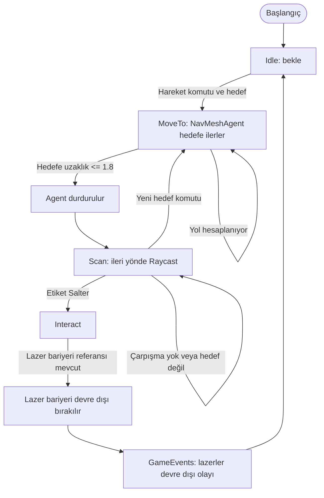
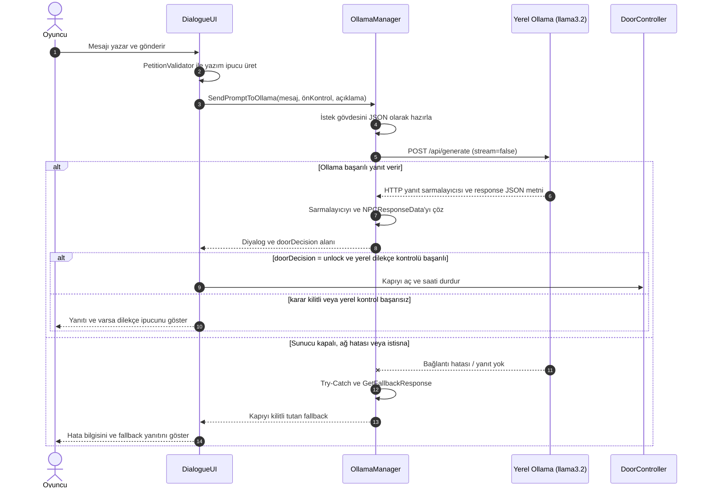

# Breakpoint – Vize Haftası Kütüphane Firarı

Kocaeli Üniversitesi Teknoloji Fakültesi Bilişim Sistemleri Mühendisliği Bölümü Yazılım Geliştirme Laboratuvarı I dersi kapsamında geliştirilen Unity tabanlı macera oyunu prototipidir.

## İçindekiler

- [Proje özeti](#proje-özeti-ve-giriş)
- [Mimari ve OOP tasarımı](#mimari-ve-oop-tasarımı)
- [Robot ve oyuncu kontrolleri](#robot-ve-oyuncu-kontrolleri)
- [Yerel LLM ve diyalog mimarisi](#yerel-llm-ve-diyalog-mimarisi)
- [Hata yönetimi](#hata-yönetimi)
- [Kurulum ve çalıştırma](#kurulum-ve-çalıştırma)
- [Ekran görüntüleri](#ekran-görüntüleri)
- [Sonuç ve geliştirme alanları](#sonuç-ve-geliştirme-alanları)

## Proje özeti ve giriş

Vize haftasında gece boyunca kütüphanede çalışan bir mühendislik öğrencisi, binanın kilitlenmesiyle içeride mahsur kalır. Oyuncu, yardımcı robotuyla lazer barikatını devre dışı bırakıp çıkışa ulaşmaya çalışır. Çıkış kapısında karşısına çıkan kuralcı Nöbetçi Kütüphaneci’ye serbest metinle mazeret sunar. Yerel dil modeli diyalog yanıtını ve kapı kararını üretir.

Projenin amacı; Unity’de sahne ve oyun durumu yönetimini, NavMesh tabanlı otonom hareketi, algılayıcılarla etkileşimi, olay tabanlı bileşen iletişimini ve yerel dil modeliyle asenkron etkileşimi tek bir oynanabilir senaryoda birleştirmektir. Temel oyun döngüsü şöyledir:

1. Oyuncu koridor bölümünde robotun şaltere gitmesini sağlar.
2. Robot NavMesh üzerinde hedefe ilerler, Raycast ile şalteri algılar ve lazerleri kapatır.
3. Oyuncu kapı bölümüne geçer ve Nöbetçi Kütüphaneci’ye bir mesaj yazar.
4. LLM yanıtı yapılandırılmış veri olarak alınır; kütüphanecinin kapıyı açma/kapalı tutma kararı oyuna uygulanır.
5. `GameClock` 04:00–09:00 aralığında ilerler; süre dolduğunda oyun zaman aşımı olayını yayınlar.

## Ekip

| Üye | Sorumluluk |
|---|---|
| **ElifH** | Fiziksel dünya ve robot ajanı: NavMesh, sensörler ve koridor bölümü |
| **ElifG** | Diyalog sistemi, JSON yanıt akışı ve kapı bölümü |

## Mimari ve OOP tasarımı

Kod, `Assets/_Project/Scripts` altında sorumluluklarına göre `Core`, `LLM`, `Player` ve `Robot` klasörlerine ayrılmıştır. Sahne dosyaları `Assets/Scenes` altındadır (`MainMenu`, `Level_Corridor` ve `Level_Door`). Bileşenler Unity `MonoBehaviour` yaşam döngüsüne uyumlu, Inspector üzerinden yapılandırılabilir nesneler olarak tasarlanmıştır.

### Temel sınıflar

| Sınıf | Sorumluluk |
|---|---|
| `GameManager` | Oyun akışını ve yüksek seviyeli durum geçişlerini koordine eder. |
| `GameState` | Oyunun durumunu temsil eden ortak durum tanımlarını sağlar. |
| `GameEvents` | Lazerlerin devre dışı bırakılması ve zamanın dolması gibi olayları yayınlar. |
| `GameClock` | Oyun içi saati 04:00–09:00 arasında ilerletir; süre dolunca `OnTimeExpired` olayını tetikler. Varsayılan gerçek süre 600 saniyedir. |
| `OllamaManager` | Ollama HTTP isteğini gönderir, yanıt sarmalayıcısını çözer ve uygulama verisini üretir. |
| `NPCResponseData` | NPC metni ile yapılandırılmış kapı kararını taşır. |
| `DialogueUI` | Oyuncu metnini alır, yanıtı ekranda sunar ve ilgili oyun bileşenlerine aktarır. |
| `DoorController` | Kapının açılma/kilit ve güvenlik kararlarını oyun nesnesine uygular. |
| `RobotController` | Robotun FSM durumlarını, NavMesh hedef hareketini, Raycast taramasını ve şalter etkileşimini yürütür. |
| `PlayerController` | Oyuncu girdisi ve oyuncu hareketi sorumluluklarını yürütür. |

### OOP ve SOLID ilkeleri

- **Tek Sorumluluk (SRP):** Saat, diyalog, kapı, robot hareketi ve LLM iletişimi ayrı bileşenlerde tutulur. Örneğin `GameClock` HTTP veya UI işlemi yapmaz.
- **Açık/Kapalı (OCP):** Olaylara abone olan yeni sistemler, temel yayıncı akışını değiştirmeden eklenebilir. Yeni NPC davranışları da yanıt işleme sınırında genişletilebilir.
- **Liskov Yerine Geçme (LSP):** Projede belirgin bir kalıtım hiyerarşisi kullanılmamaktadır; Unity bileşenleri kompozisyonla bir araya getirilir.
- **Arayüz Ayrımı (ISP):** `ICursorController` gibi küçük arayüzler, tüketicilerin ihtiyaç duymadıkları davranışlara bağımlı olmamasını sağlar.
- **Bağımlılığı Tersine Çevirme (DIP):** `GameEvents` üzerinden gevşek bağlı iletişim, doğrudan nesne referanslarına olan ihtiyacı azaltır. Mevcut LLM/UI bağlantılarında Unity Inspector referansları da kullanılır; bu nedenle DIP uygulaması tüm sistemde mutlak değildir.

Bu ilkeler, mevcut kodun gözlemlenebilir yapısına göre açıklanmıştır; her sınıf için bağımsız arayüz veya dependency injection altyapısı bulunduğu iddia edilmemektedir.

## Robot ve oyuncu kontrolleri

Robot `NavMeshAgent` ile zemine bake edilmiş NavMesh üzerinde yol bulur. Takip ve FSM güncellemeleri 0,15 saniyelik coroutine ile yürütülür. Takip mesafesi doğrudan `Vector3.Distance` ile ölçülür; durma mesafesi 1,8 birimdir. Oyuncu şaltere tıklarsa `PlayerController`, `Salter` etiketli hedefi doğrudan robota iletir. Robot hedefe yaklaşınca şalteri çalıştırır; normal hedeflerde `sensorPoint` üzerinden ileri raycast kullanılır. Tam yol bulunamazsa robot kısmi yolun erişilebilir ucuna ilerler. Koridor sahnesinde zemin üzerindeki NavMesh yüzeyi kullanılmalı; Robot altındaki eski ikinci `NavMeshSurface` devre dışıdır.

Koridor kontrolleri: `WASD` veya ok tuşlarıyla hareket, dayanıklılık varken `Shift` ile koşma, fareyle bakış, `Space` ile zıplama, `F` ile el feneri, sol tıklamayla robot komutu ve `Escape` ile duraklatma menüsü açılır. Zıplama tuşu kısa süre önceden basılırsa giriş hatırlanır; platform kenarından ayrıldıktan hemen sonra da zıplanabilir. Bu süreler Inspector’dan ayarlanabilir. Oyuncu yürürken ve koşarken Inspector’dan atanabilen rastgele ayak sesi klipleri farklı aralıklarla çalar. Hareket ivmeli çalışır; havadaki yön kontrolü Inspector’dan ayrı ayarlanabilir. Koşarken kamera görüş açısı yumuşakça genişler. Gamepad’de sol çubuk hareket, sol çubuk tuşuna basılı tutma koşma, sağ çubuk bakış, A/× zıplama, X/□ el feneri, sağ omuz tuşu robot komutu, Start duraklatmadır. Koşu enerjisi dinlenirken kısa bir gecikmeyle dolar; tamamen tükenirse kısmen dolana kadar koşma kilitlenir. Enerji ekranda gösterilir. Duraklatma menüsünden ana ses, fare hassasiyeti, ters dikey bakış ve tam ekran ayarlanıp kaydedilebilir. Girişler Unity Input System paketini kullanır. Nişangâh şaltere bakarken yeşile döner ve robot komut ipucunu gösterir.

Ana menü gamepad ile de kullanılabilir: D-pad veya sol çubukla seçenek değişir, A/× seçer, B/○ çıkar.

Kazanma ve kaybetme ekranlarında geçen oyun süresi gösterilir; kazanma süresi yerel en iyi kaçış rekoru olarak saklanır ve ana menüde de gösterilir. D-pad veya sol çubukla “Tekrar Oyna” ve “Ana Menü” arasında seçim yapılır; A/× seçer, B/○ ana menüye döner.

Duraklatma menüsünde gamepad ile D-pad/sol çubuk seçenekleri değiştirir; sol/sağ ses ve fare hassasiyetini ayarlar, A/× ters bakış, tam ekran ve titreşim seçeneklerini değiştirir. “Varsayılan Ayarları Sıfırla” tüm tercihleri başlangıç değerlerine döndürür. Ana menüye dönme ve yeniden başlatma için onay gerekir. B/○ oyuna döner.

Saat göstergesinin yanında hedef paneli bulunur. Şalter devre dışı bırakılınca hedef çıkışa ulaşmak olarak değişir; kapı sahnesinde dilekçe ve çıkış adımlarını gösterir.

Robot için HUD'da renk kodlu bir durum göstergesi bulunur: devre dışı, takipte, hedefe ilerliyor, şalteri tarıyor ve beklemede durumları oyun sırasında görünür.

### Robot FSM akışı



## Yerel LLM ve diyalog mimarisi

Ollama, modelin yerel makinede çalışmasını sağlar; böylece oyun diyaloğu için harici bir bulut servisine ihtiyaç duyulmaz. `llama3.2` modeli hafif kurulumlarda denenebilir ve istekler ana Unity iş parçacığını uzun süre bloklamadan `UnityWebRequest` ve `Task.Yield` ile beklenebilir. Bu yaklaşım donanım kaynaklarına bağlıdır; 1B varyantının düşük VRAM ve kısa gecikme avantajı hedefleniyorsa kullanılan model etiketi kurulumda açıkça `llama3.2:1b` olarak seçilmelidir. Depodaki varsayılan `modelName` değeri şu an `llama3.2`’dir.

### İstek ve yanıt sözleşmesi

`PetitionValidator`, [PetitionRules_Default.asset](Assets/_Project/Data/PetitionRules_Default.asset) içindeki ölçütlerle dilekçeyi kontrol eder: 40–500 karakter, resmî hitap, mazeret ve açık çıkış talebi. Giriş uzunluğu sınırlandırılır; sayaç ve eksik koşul mesajı yazarken gösterilir. Güvenilir ön kontrol sonucu ve açıklaması Ollama'ya bağlam olarak gönderilir. Kapı kararını Ollama yapılandırılmış `doorDecision` alanıyla verir; `unlock` eylemi ayrıca yerel doğrulamadan geçmelidir. Bu ikinci kontrol, modelin yanlış pozitif kararını engeller. Bozuk/eksik karar veya yerel kontrol başarısızlığı kapıyı açmaz. Kütüphaneci yanıtları okunaklı bir yazı animasyonuyla sunulur; Enter/A önce yazıyı tamamlar, tekrar basıldığında gönderir; Esc/B ile kapatılabilir. İstek sırasında animasyonlu bekleme ve süre göstergesi çıkar; bağlantı hatasında dilekçe korunarak yeniden denenebilir. Ret ve kabul yanıtları farklı görsel/işitsel geri bildirim alır. Kapı açılırken sıcak tonlu çıkış ışığı yumuşakça yükselip kısa bir vurgu yapar; eşikten seyrek ışık parçacıkları süzülür. Diyalog paneli yanıt bittikten kısa süre sonra kapanır; oyun saati durur, oyuncu çıkışa yürür ve kapı eşiğini geçince kazanma ekranı açılır.

`NPCResponseData` ve `OllamaManager`, diyalog metniyle birlikte kapı kararını taşıyan yapılandırılmış yanıtı işler:

```json
{
  "dialogue": "Kütüphanecinin oyuncuya yanıtı",
  "doorDecision": "unlock"
}
```

Ollama `/api/generate` uç noktasının dış yanıtındaki `response` metni ayrıca çözülür. İç JSON `NPCResponseData` nesnesine dönüştürülür; boş diyalog veya izin verilmeyen karar değeri geçersiz kabul edilir. Mevcut projede Newtonsoft.Json değil Unity `JsonUtility` kullanılmaktadır.

### Diyalog istek/yanıt sırası



## Hata yönetimi

LLM, oyun döngüsünün dış bağımlılığı olduğundan başarısızlığı temel oyun akışını çöktürmemelidir. `OllamaManager` şu güvenlik adımlarını uygular:

- `UnityWebRequest` başarısız sonuç döndürürse uyarı kaydı üretir ve `GetFallbackResponse` döndürür.
- İstek sırasında oluşan istisnalar `try-catch` ile yakalanır; arayüze güvenli varsayılan yanıt verilir.
- Ollama dış JSON sarmalayıcısı boşsa, içerideki JSON bozuksa veya diyalog/karar alanlarından biri yok ya da geçersizse parse hatası fallback ile karşılanır.
- Ollama bağlantısı veya JSON yanıtı başarısızsa oyun devam eder, kapı kilitli kalır ve fallback yanıtı gösterilir.
- İstek, yanıt tamamlanana kadar `Task.Yield` ile beklenir. Bu, Unity ana iş parçacığını senkron beklemeyle kilitlememek içindir.

`OllamaManager` isteği varsayılan 60 saniyede zaman aşımına uğrar; sıcaklık (0–2 aralığı, varsayılan 0,4) ve yanıt token sınırı (varsayılan 80) Inspector’dan ayarlanabilir. `Task.Yield` asenkron bekleme sağlar, tek başına zaman aşımı süresi belirlemez.

## Kurulum ve çalıştırma

1. Depoyu Unity Hub ile, proje tarafından kullanılan uyumlu Unity sürümünde açın. Render ayarları Universal Render Pipeline (URP) yapılandırması içerir.
2. Ollama’yı yerel makineye kurup çalıştırın. Model etiketini indirin (ör. `ollama pull llama3.2`). 1B varyantı hedefleniyorsa hem model indirme hem de `OllamaManager.modelName` değeri `llama3.2:1b` ile eşleştirilmelidir.
3. Ollama servisinin varsayılan `http://localhost:11434` adresinde erişilebilir olduğunu doğrulayın. Projedeki uç nokta `http://localhost:11434/api/generate` şeklindedir.
4. `Assets/Scenes/MainMenu.unity` başlangıç menüsüdür; Build Settings'te ilk sıradadır. `Assets/Scenes/Level_Corridor.unity` koridor, `Assets/Scenes/Level_Door.unity` kapı bölümü için kullanılır. Menü `MainMenuUI.cs` üzerinden oyun akışını başlatır.
5. Unity Editor’da koridor sahnesinden oyunu başlatın. `Player Settings > Other Settings > Active Input Handling` değeri `Input System Package (New)` olmalıdır. Koridor sahnesinde zemine ait NavMeshSurface bake edilmiş ve etkin olmalı; Robot altındaki eski NavMeshSurface devre dışı kalmalıdır. Robotun NavMeshAgent bileşeni zemindeki NavMesh üzerinde başlamalıdır. Şalterin etiketi `Salter` olmalı ve lazer bariyeri referansı atanmalıdır.

LLM servisi çalışmıyorsa oyun fallback yanıtıyla devam eder; doğal dil diyalog üretimi kullanılabilir olmaz.

## Koridor güvenlik noktası görsel geçişi

Son kitaplık sıraları ahşap bitiş panelleriyle tamamlanır; enkaz alanından güvenlik noktasına koyu teal halı ve pirinç şeritlerle temiz bir geçiş yapılır. Güvenlik görevlisinin arkasındaki duvar açıklığında kahverengi çift kanatlı, pirinç kulplu “PERSONEL ÇIKIŞI” kapısı bulunur. Kapı dekoratiftir ve collider içermez; mevcut koridor geçiş tetikleyicisini engellemez. Bu dekorlar `LibraryVisualPass` tarafından oluşturulur. Yeniden üretmek için Unity menüsünden `Breakpoint > Art > Build Library Visuals (Corridor + Librarian)` komutunu çalıştırın; komut koridor ve kapı sahnelerinin görsel düzenlemelerini yeniler.

## Door sahnesi görsel atmosfer

Kütüphaneci bankosundaki mevcut lamba ve kitaplara ek olarak oyun başlarken düşük poligonlu dilekçe sayfaları, yazı çizgileri, mühür, kalem ve kayıt defteri oluşturulur; evrak alanı masa lambasıyla aydınlatılır. Çıkış kapısının collider konumuna göre büyük, sıcak ışıklı “ÇIKIŞ” tabelası yerleştirilir. Kapı çevresine ahşap eşik ve saçak eklenir; kapı açılınca oyuncunun bulunduğu noktadan eşiğe uzanan zemin okları belirir ve kapının ardında ay ışıklı şehir silueti görünür. Bu ayrıntılar dış model veya görsel dosyası gerektirmez; `DoorSceneDressing` bileşeniyle sahneye eklenir. Door sahnesinin genel aydınlatması daha sıcak ve daha dengeli bir seviyeye ayarlanır.

## Ekran görüntüleri

| Ana menü | Robot ve görev arayüzü |
|---|---|
|  |  |

| Koridor ve güvenlik noktasına yaklaşım | Robotla raf enkazını temizleme |
|---|---|
|  |  |

| Kütüphaneciyle dilekçe diyaloğu | Kapı açıldıktan sonraki çıkış |
|---|---|
|  |  |

## Sonuç ve geliştirme alanları

Breakpoint; NavMesh ile otonom hareketi, Raycast algılamasını, FSM tabanlı robot davranışını, olay güdümlü oyun sistemlerini ve yerel LLM ile diyalog prototipini bir araya getirir. Yerel model kullanımı, oyuncu girdisinin harici bir servise gönderilmeden işlenebilmesine imkân verir. Güvenli fallback sayesinde LLM erişimi olmadığında temel hata akışı tanımlıdır.

Yerel modelin yanıt süresi donanıma bağlıdır ve model geçersiz JSON üretebilir; bu durumlarda oyun kapıyı kilitli tutan fallback yanıtını kullanır. Dilekçe doğrulaması resmî hitap, mazeret ve çıkış talebini anahtar sözcüklerle denetler.

İleride geliştirilebilecek alanlar:

- İlk oynanışta hareket, robot komutu ve dilekçe yazımını anlatan kısa bir yönlendirme eklemek.
- Oyuncunun bulduğu çevresel ipuçlarını dilekçede kullanabileceği isteğe bağlı bir hazırlık sistemi eklemek.
- Robotun görüş alanı, alternatif rota ve dinamik engel durumları için FSM’yi genişletmek.

## Lisans ve atıf

Bu proje ders/prototip çalışmasıdır. Door sahnesindeki oda ambiyansı ve saat sesi Pixabay Content License altında kullanılır. Pixabay bu içerikler için atıf zorunluluğu belirtmez; kaynak bilgisi izlenebilirlik için listelenmiştir.

| Varlık | Katkıcı | Kaynak / lisans |
|---|---|---|
| The Ambience Room Tone (`DoorScene_RoomTone.mp3`) | SoundsForYou | [Pixabay](https://pixabay.com/sound-effects/household-the-ambience-room-tone-139064/) · Pixabay Content License |
| Clock Ticking Ambience (`DoorScene_ClockTick.mp3`) | Alex_Jauk | [Pixabay](https://pixabay.com/sound-effects/film-special-effects-clock-ticking-ambience-202980/) · Pixabay Content License |

Diğer üçüncü taraf varlıkların lisans ve atıfları dağıtımdan önce ayrıca incelenmelidir. Pixabay Content License, içeriklerin tek başına yeniden dağıtımına izin vermez; ilgili [lisans özeti](https://pixabay.com/service/license-summary/) incelenebilir.
